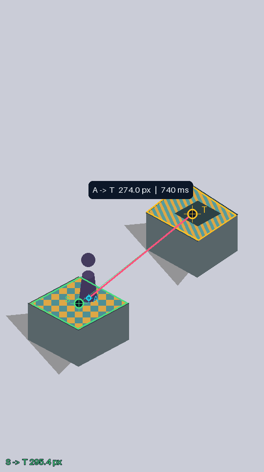

# JumpPilot

Windows 本地跳一跳视觉助手。当前版本：**v1.4**。

从游戏画面识别经典紫色棋子的落脚点、当前平台顶面中心和下一平台顶面中心，结合距离—按压时长标定进行单步或连续跳跃。包含低置信度人工确认和可选的得分/落点反馈校准。

## 下载

- [最新发布](https://github.com/Yangjunjie-Lin/JumpPilot/releases/latest)
- [v1.4 EXE：直接运行](https://github.com/Yangjunjie-Lin/JumpPilot/releases/download/v1.4/JumpPilot-v1.4.exe)
- [v1.4 完整包：程序、源码、示例、说明和依赖许可](https://github.com/Yangjunjie-Lin/JumpPilot/releases/download/v1.4/JumpPilot-v1.4-Windows.zip)
- [SHA256 校验值](SHA256SUMS.txt)

成品为 Windows 10/11 x64 单文件程序，无需安装 Python。程序未进行代码签名；遇到安全警告不要盲目绕过，可以检查源码后自行构建。

## v1.4 更新

- 加强带条纹、棋盘纹理、文字、内圈和小装饰的平台顶面定位，结合可见边缘、圆弧和透视四角确定顶心。
- **S**：当前平台顶心；**T**：下一平台顶心；**A**：棋子实际落脚点。显示 S→T 顶心间距，实际按压和学习仍使用 A→T，避免落脚偏移带来累积误差。
- 当前平台中心独立识别，可人工修改；识别不到时不会把棋子坐标冒充平台中心。
- 只选择当前位置上方最近一层的下一目标，排除脚下平台，减少后期多个平台同时出现时的干扰。
- 保留圆形平台拟合、低置信度暂停、单帧人工评分与确认、`0 = 无限步数` 和可选的有界学习校准。



上图为合成几何测试图，不是实景成功案例。断裂边缘恢复出的目标评分最多 79%，在默认 84% 自动阈值下会等待人工确认；严重遮挡、异形或特殊运动规则仍可能需要人工处理。

## 快速开始

1. 下载完整包并解压，启动 `JumpPilot-v1.4.exe`。默认打开离线示例，不会自动按压。
2. 点击“框选游戏”，仅框选完整的竖屏游戏区域。保持窗口位置、缩放和裁剪范围稳定，避免助手遮挡游戏。
3. 核对 S/T/A；必要时选择相应标点模式并点击预览修正。将按压点设在游戏内空白处。
4. 先校准参数并单步试跳。默认系数未经你的游戏验证，不保证首次跳跃成功。
5. 确认可靠后启动连续跳跃；本轮步数填 `0` 表示不因步数结束，仍保留人工确认与安全停止。
6. 按 Esc、点击停止或将鼠标移到虚拟桌面左上角，可中断。

详见 [使用说明](使用说明.txt) 和 [验证记录](验证记录.txt)。请勿同时运行多个助手控制同一游戏窗口。

## 校准与安全边界

- 标准距离为实际像素距离乘以 `540 / 游戏画面宽度`；按压时长为 `gain × (k × 标准距离 + b)`。普通鼠标不提供可调物理压力。
- 自动学习默认关闭。稳定加分、可靠落地匹配且连续 3 次同方向反馈才可能调整倍率；单次最多 2%，本轮累计限制在初始倍率的 ±15%。k/b 不自动改变。
- 人工评分、点位修正和确认只对当前帧生效，不会沿用到下一跳。人工评分不是模型训练，也不是成功概率。
- 窗口移动、失焦、遮挡、画面变化异常、无法识别或时长越界会停止。无限步数不代表无人值守、自动重开或无限成功。
- 个人配置 `jump-pilot-settings.json` 不在仓库或分发包中。程序仅在你点击保存时将参数保存到程序旁边。

## 从源码运行与测试

需要 Windows 和 Python 3.12；窗口控制依赖 Windows API。

```powershell
python -m venv .venv
.venv\Scripts\python -m pip install -r requirements.txt
.venv\Scripts\python app.py

# 自动化测试：全部输入使用模拟实现，不操作真实游戏
.venv\Scripts\python -m pip install pytest
.venv\Scripts\python -m pytest -q

# 离线分析：不创建主界面，不发送鼠标输入
.venv\Scripts\python app.py --analyze prop-demo.png --output analysis.png --report analysis.json
```

发布前 **299 项自动化测试通过**。EXE 对真实示例截图及合成道具图的离线 PNG/JSON 输出均与源码结果一致。这些检查不代表真实游戏的连续成功率或特殊道具的通用兼容性。

## 自行构建 EXE

在仓库根目录运行：

```powershell
.venv\Scripts\python -m pip install pyinstaller==6.16.0
.venv\Scripts\python -m PyInstaller --onefile --windowed --name JumpPilot-v1.4 --add-data "sample.png;." app.py
```

结果位于 `dist/JumpPilot-v1.4.exe`。仓库只保存源码和示例；EXE、完整包保存在 GitHub Releases，不放入 Git 历史。

## 限制与用途

这是针对示例游戏视觉特征的保守启发式工具，不是通用游戏识别模型，不读取游戏内存、不接入游戏账号、不发送屏幕数据。没有提供手机原生控制或 ADB 支持；投屏鼠标兼容性需要自行验证。

未在用户的真实游戏中验证特殊道具、输入延迟、蓄力物理和长时间连续运行。只用于个人学习、自有测试或获得允许的场景，请遵守游戏及平台规则。第三方依赖许可随附于 [licenses](licenses/)。
